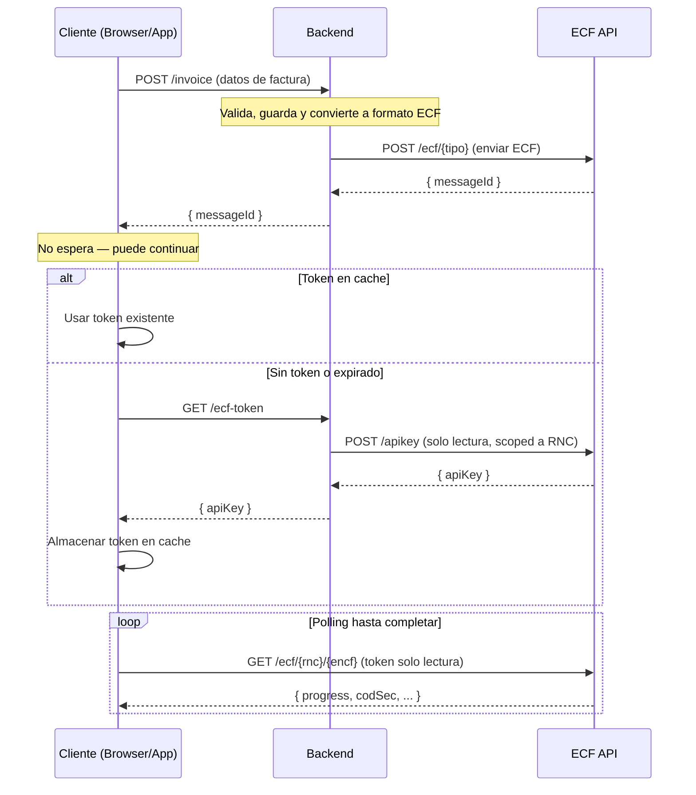

# ecf-dgii

[](https://pypi.org/project/ecf-dgii/)
[](https://pypi.org/project/ecf-dgii/)
[](LICENSE)

SDK de Python para la **API ECF DGII** — Comprobantes Fiscales Electrónicos de la República Dominicana.

## Instalación

```bash
pip install ecf-dgii
```

## Inicio rápido

Cada tipo de e-CF tiene sus propios modelos (`Ecf31ECF`, `Ecf32ECF`, … `Ecf47ECF`) y su
método de envío (`send_ecf31`, `send_ecf32`, …). Los modelos se construyen con
argumentos en *snake_case*; el SDK los serializa con los nombres de la API.

```python
import asyncio
import datetime

from ecf_dgii import EcfClient, PollingOptions
from ecf_dgii.generated.models import (
    Ecf32Comprador, Ecf32ECF, Ecf32Emisor, Ecf32Encabezado, Ecf32IdDoc,
    Ecf32IndicadorBienoServicioType, Ecf32IndicadorFacturacionType, Ecf32Item,
    Ecf32TipoIngresosValidationType, Ecf32TipoPagoType, Ecf32Totales,
    Ecf32VersionType, TipoeCFType,
)


async def main():
    ecf = Ecf32ECF(
        encabezado=Ecf32Encabezado(
            version=Ecf32VersionType.VERSION1_0,
            id_doc=Ecf32IdDoc(
                tipoe_cf=TipoeCFType.FACTURADECONSUMOELECTRONICA,
                encf="E320000000001",
                tipo_ingresos=Ecf32TipoIngresosValidationType.VALUE_0,  # "01"
                tipo_pago=Ecf32TipoPagoType.CONTADO,
            ),
            emisor=Ecf32Emisor(
                rnc_emisor="131460941",
                razon_social_emisor="DOCUMENTOS ELECTRONICOS DE 02",
                direccion_emisor="AVE. ISABEL AGUIAR NO. 269",
                fecha_emision=datetime.date.today(),
            ),
            comprador=Ecf32Comprador(),
            totales=Ecf32Totales(
                monto_gravado_total=100.0,
                monto_gravado_i1=100.0,
                itbi_s1=18,
                total_itbis=18.0,
                total_itbis1=18.0,
                monto_total=118.0,
            ),
        ),
        detalles_items=[
            Ecf32Item(
                numero_linea=1,
                indicador_facturacion=Ecf32IndicadorFacturacionType.ITBIS1_18PERCENT,
                nombre_item="Producto",
                indicador_bieno_servicio=Ecf32IndicadorBienoServicioType.BIEN,
                cantidad_item=1,
                precio_unitario_item=100.0,
                monto_item=100.0,
            )
        ],
    )

    async with EcfClient(api_key="tu-token-jwt", environment="test") as client:
        # Solo encolar (retorna messageId y progress=New)
        queued = await client.send_ecf32(ecf)
        print(queued.message_id, queued.progress)

        # …o encolar y esperar el resultado de la DGII
        # result = await client.send_ecf32_and_poll(ecf)
        # print(result.estatus, result.cod_sec, result.impresion_url)


asyncio.run(main())
```

## Configuración

### Autenticación

El API key (token JWT Bearer) se puede proporcionar de dos formas:

```python
# Parámetro directo
client = EcfClient(api_key="tu-token-jwt")

# Variable de entorno
# export ECF_API_KEY=tu-token-jwt
client = EcfClient()
```

### Ambientes

```python
client = EcfClient(api_key="...", environment="test")   # Pruebas
client = EcfClient(api_key="...", environment="cert")   # Certificación
client = EcfClient(api_key="...", environment="prod")   # Producción

# URL base personalizada
client = EcfClient(api_key="...", base_url="https://custom.api.url")
```

## Funcionalidades

### Enviar ECF con polling automático

Los métodos `send_ecfXX_and_poll` envían el comprobante y consultan
`GET /ecf/{rnc}/message/{messageId}` con backoff exponencial hasta que `progress`
sea `Finished` (retorna la respuesta) o `Error` (lanza `EcfProcessingError`).

```python
from ecf_dgii import PollingOptions

result = await client.send_ecf31_and_poll(
    ecf,
    polling_options=PollingOptions(
        initial_delay=1.0,     # segundos
        max_delay=30.0,        # segundos
        max_retries=60,
        backoff_multiplier=2.0,
        timeout=300.0,         # timeout total en segundos
    ),
)
print(result.estatus, result.cod_sec, result.fecha_firma, result.impresion_url)
```

## Arquitectura Backend / Frontend



### Flujo detallado

1. El **cliente** (browser/app) envía los datos de la factura al **backend** (`POST /invoice`, `/order`, `/sale`)
2. El **backend** valida, guarda y convierte la factura interna al formato ECF
3. El **backend** envía el ECF a la API de ECF SSD (`POST /ecf/{tipo}`) y recibe un `messageId`
4. El **backend** retorna el `messageId` al cliente — **el cliente no espera**, puede continuar
5. Cuando el cliente necesita consultar el estado del ECF, usa `EcfFrontendClient` que internamente:
   - Verifica si hay un **token de solo lectura** en cache
   - Si **no existe o expiró**: llama a `getToken()` (que el consumidor provee — típicamente un `fetch('/ecf-token')` a su backend), luego llama a `cacheToken(token)` para almacenarlo
   - Si la API retorna **401**: automáticamente llama a `getToken()` de nuevo, actualiza el cache, y reintenta
6. El cliente hace **polling** directamente contra la API de ECF SSD (`GET /ecf/{rnc}/{encf}`) hasta que `progress` sea `Finished`

```python
from ecf_dgii import create_frontend_client
import requests

# 1. Enviar la factura al backend
res = requests.post("https://my-backend/api/v1/invoices", json=invoice_data)
result = res.json()  # { "messageId": "...", "rnc": "...", "encf": "..." }
# El cliente no espera — puede continuar con otras operaciones

# 2. Crear cliente de solo lectura (get_token se llama automáticamente)
frontend = create_frontend_client(
    get_token=lambda: requests.get("https://my-backend/api/v1/ecf-token").json()["apiKey"],
    environment="prod",
    # cache_token usa archivo encriptado en disco por defecto
)

# 3. Consultar el estado del ECF
ecf = frontend.query_ecf(result["rnc"], result["encf"])
ecfs = frontend.search_ecfs(result["rnc"])
```

### Gestión de empresas

```python
# Listar empresas
companies = await client.get_companies(page=1, limit=10)

# Obtener por RNC
company = await client.get_company_by_rnc("123456789")

# Crear o actualizar
from ecf_dgii import UpsertCompanyRequest
await client.upsert_company(UpsertCompanyRequest(
    rnc="123456789",
    legalName="Mi Empresa SRL",
    name="Mi Empresa",
))

# Eliminar
await client.delete_company("123456789")
```

### Gestión de certificados

```python
# Obtener certificados
certs = await client.get_certificate("123456789")

# Subir certificado
with open("cert.p12", "rb") as f:
    await client.update_certificate("123456789", f, password="cert-password")
```

### Consultar ECFs

```python
# Consultar por RNC y eNCF
results = await client.query_ecf("123456789", "E310000000001")

# Buscar con filtros
from ecf_dgii import AllTipoECFTypes
page = await client.search_ecfs(
    "123456789",
    tipos_ecfs=[AllTipoECFTypes.FACTURADECREDITOFISCALELECTRONICA],
    from_fecha_emision="2024-01-01T00:00:00",
    page=1,
    limit=50,
)
```

### Aprobación comercial

```python
from ecf_dgii.generated.models import EstadoType, SendAcecfRequest

# message_id del e-CF recibido (ver search_ecf_reception_requests_by_rnc)
await client.send_aprobacion_comercial(
    message_id,
    SendAcecfRequest(estado_type=EstadoType.ECFACEPTADO),
)
```

### Anulación de rangos

```python
from ecf_dgii import AnulacionRequest, DetalleAnulacionRequest, SecuenciaRequest, ECFType
result = await client.anulacion_rangos(
    "123456789",
    AnulacionRequest(
        cantidaDeNcfAnulados=5,
        detalleAnulacion=[
            DetalleAnulacionRequest(
                tipoEcf=ECFType.ECF31,
                cantidadeNcfAnulados=5,
                noLinea=[1],
                secuencias=[SecuenciaRequest(desdeEncf="E310000000001", hastaEncf="E310000000005")],
            ),
        ],
    ),
)
```

### Consultas DGII

```python
# Directorio
entries = await client.consulta_directorio_listado("123456789")

# Estado
estado = await client.consulta_estado(
    "123456789",
    rnc_emisor="123456789",
    ncf_electronico="E310000000001",
    rnc_comprador="987654321",
    codigo_seguridad="ABC123",
)

# Estatus servicios
servicios = await client.estatus_servicio("123456789")
```

## Manejo de errores

```python
from ecf_dgii import (
    EcfApiError,
    EcfAuthenticationError,
    EcfConnectionError,
    EcfProcessingError,
    EcfRateLimitError,
    EcfServerError,
    EcfValidationError,
    PollingTimeoutError,
)

try:
    result = await client.send_ecf31_and_poll(ecf)
except EcfValidationError as e:          # 400: corregir el comprobante
    print(f"Solicitud inválida: {e.message}")
except EcfAuthenticationError:           # 401
    print("API key inválido")
except EcfProcessingError as e:          # la DGII rechazó el e-CF
    print(f"DGII rechazó: {e.message}")
except (EcfConnectionError, EcfServerError, EcfRateLimitError, PollingTimeoutError):
    print("Falla transitoria: reintentar más tarde (o usar contingencia)")
except EcfApiError as e:
    print(f"Error de API {e.status_code}: {e}")
```

## Licencia

MIT
